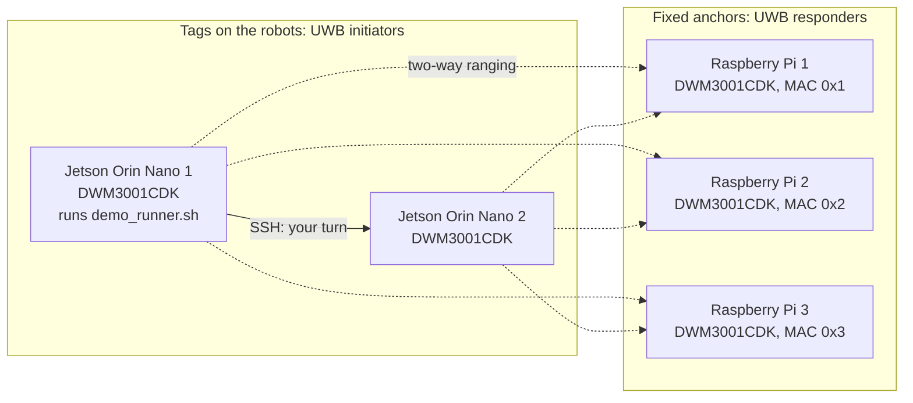

# UWB V2X testbed

Indoor ultra-wideband (UWB) ranging and 2D LiDAR obstacle detection for a three-robot V2X testbed, built on Qorvo DWM3001CDK boards, NVIDIA Jetson Orin Nano and Raspberry Pi 4 (April to May 2026).

The main result: two robot tags ranging with three fixed anchors on Qorvo's UCI firmware. Started together, the second tag only ever saw timeouts; a small scheduler that makes the tags take turns fixed it.

## What was achieved

| Milestone | Result | Evidence |
|---|---|---|
| 1 tag and 1 anchor, CLI firmware, STS enabled | Ranging at 151 to 160 cm | [log](logs/uwb-cli/08_one-to-one_SUCCESS.log) |
| 1 tag and 4 anchors, CLI firmware | Ranging to all four in one round (`n_measurements=4`) | [log](logs/uwb-cli/10_one-tag-four-anchors_SUCCESS.log) |
| 2 tags, each ranging with every anchor, CLI firmware | Not achieved: a board runs one ranging session and refuses a second | [stacking test](logs/uwb-cli/13_stacking-test_tag-1.log) |
| 1 tag and 3 anchors, UCI firmware | Ranging to all three anchors. Anchor output from one run: 281 to 288, 222 to 228 and 287 to 288 cm | [log](logs/uwb-uci/08_anchors_ranging-ok_one-tag.log) |
| 2 tags and 3 anchors, UCI, started together | The second tag gets only timeouts | [log](logs/uwb-uci/10_two-tags_jetson-2-all-timeouts.log) |
| **2 tags and 3 anchors, UCI, taking turns** | **Working: both tags range to all three anchors in turn** | [`demo_runner.sh`](code/uwb-uci/demo_runner.sh), [both tags in one run](logs/uwb-uci/24_demo_both-tags-ok_then-unknown-port.log), [final run](logs/uwb-uci/26_demo_FINAL_SUCCESS.log) |
| LiDAR obstacle detection (ROS 2 node) | Working on the bench: "critical" when something is close, "warning" a little further away | [`obstacle_node.py`](code/lidar/lidar_obstacle_detector/obstacle_node.py) |
| LiDAR SLAM with `slam_toolbox` | Not finished: no odometry source without a moving base | [log](logs/lidar/05_2026-05-26_topics-nodes_and_tf-without-odom.log) |

Not started yet: turning the three distances into an (x, y) position, a ROS 2 node that publishes it, fusion with LiDAR and wheel odometry, the third tag, and mounting everything on the robots. See [`docs/next-steps.md`](docs/next-steps.md).

## The system

Each board connects to its host over USB and is driven with Qorvo's Python tools (`run_fira_twr.py`, SDK `DW3_QM33_SDK_1.1.1`, UCI firmware 2.0.0). Radio settings are the SDK defaults: channel 9, double-sided two-way ranging, one round every 200 ms. Jetson 1 also runs the RPLIDAR A2M12 and the ROS 2 Humble obstacle node. Details: [`docs/hardware.md`](docs/hardware.md) and [`config/uwb/radio-and-session-parameters.md`](config/uwb/radio-and-session-parameters.md).

## How the two-tag problem was solved

Started at the same time, the second tag only ever saw timeouts. Rather than change the firmware, a bash script on Jetson 1 makes the tags take turns:

1. Jetson 1 ranges for 3 seconds, then starts Jetson 2's 3-second turn over SSH (`ssh -T`), and repeats.
2. Each run is bounded (`-t 3`), so the Qorvo tool closes its session cleanly and the board accepts the next one without being unplugged.
3. Both tags keep the default UWB address and session. Giving them their own MAC address and session number made the anchors reject every frame (`RangingRxMacIeDecFailed`, 0x26).
4. The serial port is looked up before every run, because the board can come back under a new `/dev/ttyACM` number after a session.

The three failed attempts before it are in [`docs/errors-and-fixes.md`](docs/errors-and-fixes.md#the-two-tag-scheduler), and every version of the script is in [`code/uwb-uci/history/`](code/README.md).

## What is where

| Folder | Contents |
|---|---|
| [`docs/`](docs/README.md) | Timeline, decision log, error catalogue, hardware and parts list, UWB and LiDAR guides, command reference, next steps |
| [`code/`](code/README.md) | The scripts, each with what happened when it ran: CLI firmware scripts, the UCI scheduler and its earlier versions, the LiDAR obstacle node |
| [`config/`](config/README.md) | udev rule, SLAM and Nav2 parameter files, the radio and session parameters the boards reported |
| [`logs/`](logs/README.md) | Device and terminal output, one file per test, failures and successes |

Good places to start: [`docs/uwb/uci-firmware-guide.md`](docs/uwb/uci-firmware-guide.md) to repeat the working setup, [`docs/errors-and-fixes.md`](docs/errors-and-fixes.md) for what went wrong and how it was fixed, and [`docs/decisions.md`](docs/decisions.md) for why things are the way they are.

## About this repository

- Statements about what worked come from the logs in [`logs/`](logs/README.md).
- Board serial numbers have been removed from the logs.
- Qorvo's SDK, firmware images and calibration files are not included. They come under Qorvo's own licence and are downloaded from Qorvo.
